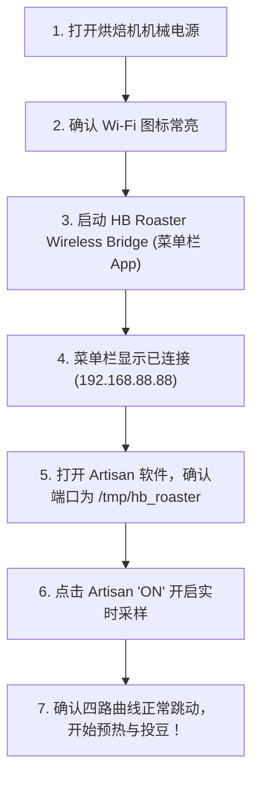

# 下次烘焙实战操作指南 (Pre-Roast 3 分钟极速核对清单)

本指南专为你在下次正式烘焙时提供最快、最稳妥的操作指引。

---

## ⏱️ 烘焙前 3 分钟速查流程图



---

## 📋 详细操作步骤

### 第一步：硬件通电与检查（约 30 秒）

1. **打开 HB 烘焙机机械电源**：
   - 确保烘焙机机身电源总开关处于“开（ON）”状态。
2. **观察机身屏幕 Wi-Fi 指示**：
   - 等待约 5~10 秒，烘焙机屏幕上的 Wi-Fi 图标由闪烁变为**常亮**。
   - 这表示烘焙机已成功分配到局域网 IP（此前实机抓取的地址为 `192.168.88.88`）。
3. **检查电脑 Wi-Fi**：
   - 确认你的 Mac 电脑与烘焙机连接在同一个 Wi-Fi 路由器的网络下。

---

### 第二步：启动无线桥接程序（约 5 秒）

直接在 Mac 上打开 **HB Roaster Wireless Bridge.app**（已安装在 `/Applications`， Spotlight 搜索 `HB` 即可直接回车打开）：

1. 打开后，顶部菜单栏常驻咖啡图标 ☕️。
2. 点击图标展开面板，会显示状态为 `已连接 (192.168.88.88)`。
3. （可选）如果你勾选了面板设置里的 **「开机/登录时自动启动后台桥接」**，以后开机即自动在后台静默运行，无需手动启动！

*(备用方案：也可在终端运行 `cd /Users/kelvinsze/Projects/hb-artisan-bridge && python3 main.py`)*

---

### 第三步：打开网页控制台核对（可选，约 20 秒）

在 Mac 的 Safari 或 Chrome 浏览器打开：
👉 [http://localhost:8080](http://localhost:8080)

- 你会看到一个暗黑风格的实时仪表盘，显示当前的 **BT（豆温）**、**ET（炉温）**、**Exhaust（出风温）** 和 **Inlet（进风温）**。
- 这代表从烘焙机硬件到 Mac 软件的数据链路 100% 通畅！

---

### 第四步：在 Artisan 中开启监控并烘焙（正式开始）

1. 打开 **Artisan** 软件。
2. 检查菜单栏 **配置 (Config)** -> **端口 (Ports)**：
   - 确认 **Comm Port** 为：
     ```text
     /tmp/hb_roaster
     ```
   - 波特率保持 `115200`，其他参数为 `8-N-1`。点击 **OK**。
3. 点击 Artisan 左上角的 **ON** 按钮：
   - 观察右上角或侧边栏 LCD，BT、ET 等数值开始实时跳动。
   - 终端状态栏会变为：`[Artisan: 正在采集]`。
4. 点击 Artisan 的 **START** 按钮开始记录曲线：
   - 开始预热、回温、转黄（Yellow）、一爆（FC）、下豆（Drop）等常规烘焙操作。

---

### 第五步：烘焙结束处理

1. 烘焙完成、豆子下豆排风冷却后，在 Artisan 中点击 **OFF** 停止采集。
2. 保存或导出本次烘焙记录 `.alog` 文件。
3. 关闭烘焙机机身电源。
4. 如果是在终端中手动运行的桥接程序，在终端中按下 `Ctrl + C` 即可优雅退出。
   *(如果是后台服务，保持常驻即可，下次通电自动连上)*。

---

## ⚠️ 烘焙现场应急预案

如果烘焙前几分钟遇到异常，请直接对照以下应急清单：

| 现场表现 | 核心原因 | 10 秒快速解决方法 |
| :--- | :--- | :--- |
| **终端提示扫不到烘焙机** | 烘焙机电源未通电，或处于休眠 | 检查机身电源总开关与屏幕 Wi-Fi 标志；执行 `python3 diagnose.py` 查验 |
| **提示无法连接广播** | Mac 上的代理（Loon / Surge / Clash）接管了网络 | 临时在状态栏将 Loon / Clash 切换为 Direct（直连）或暂停系统代理 |
| **Artisan 点击 ON 报错 Serial Exception** | 虚拟串口未建立或权限异常 | 确认终端中的 `python3 main.py` 正在运行中，终端里提示虚拟串口已创建 |
| **温度显示卡在某个数值不动** | 烘焙机 Wi-Fi 抖动断连 | 桥接器内置 6 秒看门狗，会自动尝试重新握手；必要时重启一次机器电源 |
