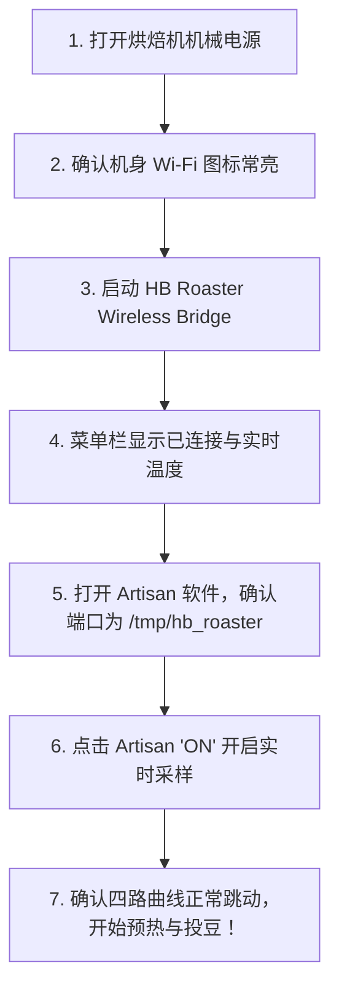

# 烘焙实战操作指南 (Pre-Roast 3 分钟极速核对清单)

本指南专为你在下次正式烘焙时提供最快、最稳妥的操作指引。

---

## ⏱️ 烘焙前 3 分钟速查流程图



---

## 📋 详细操作步骤

### 第一步：硬件通电与检查（约 30 秒）

1. **打开 HB 烘焙机机械电源**：
   - 确保烘焙机机身电源总开关处于“开（ON）”状态。
2. **观察机身屏幕 Wi-Fi 指示**：
   - 等待约 5~10 秒，烘焙机屏幕上的 Wi-Fi 图标由闪烁变为**常亮**。
   - 这表示烘焙机已成功连接至局域网路由。
3. **检查电脑 Wi-Fi**：
   - 确认你的 Mac 电脑与烘焙机连接在同一个 Wi-Fi 网络下。

---

### 第二步：启动无线桥接程序（约 5 秒）

直接在 Mac 上打开 **HB Roaster Wireless Bridge.app**（在「应用程序」目录或通过 Spotlight 聚焦搜索启动）：

1. 打开后，顶部菜单栏常驻咖啡图标 ☕️。
2. 轻触图标展开面板，状态将显示为 `已连接 (192.168.x.x)`。
3. 仪表盘上实时呈现四路温度数值。
4. （强烈推荐）点击面板右上角「齿轮设置」，勾选 **「开机/登录时自动启动后台桥接」**，以后开机即自动在后台静默运行，完全无需手动开启。

---

### 第三步：在 Artisan 中开启监控并烘焙（正式开始）

1. 打开 **Artisan** 软件。
2. 检查菜单栏 **配置 (Config)** -> **端口 (Ports)**：
   - 确认 **Comm Port** 为：
     ```text
     /tmp/hb_roaster
     ```
   - 波特率保持 `115200`，参数为 `8-N-1`。点击 **OK**。
3. 点击 Artisan 左上角的 **ON** 按钮：
   - 观察右上角或侧边栏 LCD，BT、ET、Exhaust、Inlet 数值开始实时跳动。
   - 桥接应用面板中的 Artisan 状态会同步变为绿色的 **「Artisan 采集中 (活跃)」**。
4. 点击 Artisan 的 **START** 按钮开始记录曲线：
   - 开始常规的预热、回温、转黄（Yellow）、一爆（FC）、下豆（Drop）等烘焙操作。

---

### 第四步：烘焙结束处理

1. 烘焙完成、豆子下豆排风冷却后，在 Artisan 中点击 **OFF** 停止采集。
2. 保存或导出本次烘焙记录 `.alog` 文件。
3. 关闭烘焙机机身电源。
4. 菜单栏应用保持常驻后台即可，下次烘焙机重新通电后会自动秒级重连。

---

## ⚠️ 烘焙现场应急预案

如果烘焙前几分钟遇到异常，请直接对照以下应急清单：

| 现场表现 | 核心原因 | 10 秒快速解决方法 |
| :--- | :--- | :--- |
| **应用面板提示未扫到烘焙机** | 烘焙机电源未通电，或处于休眠 | 检查机身电源总开关与屏幕 Wi-Fi 标志是否常亮；可在面板设置中手动输入机器 IP |
| **提示无法发现设备 (UDP 广播超时)** | Mac 上的代理（Loon / Surge / Clash）接管了网络 | 临时将代理切换为 Direct（直连）模式，或在面板设置中指定具体 IP |
| **Artisan 点击 ON 报错 Serial Exception** | 虚拟串口未建立或权限异常 | 确认应用已启动且处于运行状态；检查 Artisan 端口输入是否多敲了空格 |
| **温度显示卡在某个数值不动** | 烘焙机 Wi-Fi 偶发抖动断连 | 应用内置 6 秒看门狗，会自动尝试重新握手；必要时重启一次机器电源 |
